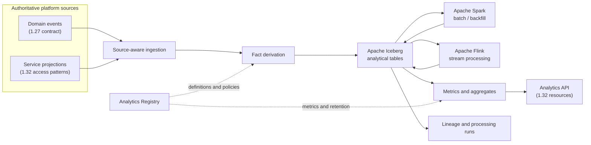

# Analytics

**Turn platform activity into governed, traceable analytical observations.**


Analytics is Synanton's derived-observation capability. It collects facts from platform events and service projections, derives analytical facts and aggregates, and exposes governed analytical results through the platform API.

**Domain services remain authoritative. Analytics is not a second source of truth, an alternative event platform, or a general-purpose BI product.** It owns analytical definitions, derived data, processing history, and lineage—not the operational state of the services it observes.

**Observe. Derive. Explain.**

**Design reference:** [SNTP-036 — Analytics module design](https://github.com/synanton/platform/issues/474) · [Synanton Platform](https://github.com/synanton/platform)

## How it works



The diagram shows the intended logical flow, not a statement that these integrations are already deployed. The ingestion and processing adapters remain behind contracts so the storage and execution technologies can evolve independently.

## Why Analytics?

| Need | Analytics' approach |
| --- | --- |
| Observe multiple platform domains | Consume governed events and eligible service projections |
| Preserve source ownership | Keep operational truth in the originating domain |
| Support streaming and batch workloads | Use Flink for continuous processing and Spark for bounded jobs |
| Store evolving analytical datasets | Use Iceberg tables with schema and partition evolution |
| Explain where a result came from | Track source references, transformations, versions, and processing runs |
| Protect sensitive information | Propagate the strictest input classification and enforce tenant boundaries |
| Correct derived results safely | Classify corrections before coordinating recalculation through Resolutor and Equalix |

Analytics is not intended to replace operational databases, the platform event substrate, or a dedicated BI/visualisation product. It provides reusable analytical capabilities and governed interfaces for those consumers.

## Core architecture

### Source integration

Analytics supports two distinct source classes. They must not be treated as interchangeable:

- **Event-derived facts** are consumed using the platform's asynchronous event contract. Analytics uses the envelope and schema registry defined by [Design 1.27](https://github.com/synanton/platform/blob/main/docs/architecture/synanton-design-1.27.md); it does not introduce a competing event envelope, schema registry, delivery protocol, or replay model.
- **Projection-derived facts** are read from explicitly eligible service projections through the resource and adapter patterns defined by [Design 1.32](https://github.com/synanton/platform/blob/main/docs/architecture/synanton-design-1.32.md). A projection is an observation of a domain-owned view, not a new authority.

Each fact retains its source type and provenance. Freshness is evaluated according to the source and its observation path; a derived result must not appear fresher than its least-fresh required input.

### Processing and storage

| Technology | Responsibility | Design boundary |
| --- | --- | --- |
| **Apache Iceberg** | Table format for analytical facts, aggregates, and retained snapshots | Analytical storage, not the event transport or operational source of truth |
| **Apache Flink** | Continuous event processing and incremental derivation | Used where streaming latency and stateful event processing justify it |
| **Apache Spark** | Bounded batch transformations, historical backfills, and large recalculation jobs | Used for scheduled or explicitly requested batch workloads |
| **Catalog and object storage** | Table discovery and durable data files | Selected per deployment; accessed through storage/catalog abstractions |

Flink and Spark are complementary execution options, not mandatory steps in every data path. A workload should use one engine when that is sufficient; introducing both requires a concrete streaming or batch use case. The design should also avoid allowing two engines to write the same table concurrently without an explicit ownership and concurrency model.

Iceberg provides table-level capabilities such as snapshots and schema/partition evolution. It does not by itself provide end-to-end event delivery guarantees, domain transactionality, tenant authorization, or analytical lineage; those remain explicit platform responsibilities.

### Analytics Registry

The Analytics Registry owns analytical metadata only:

- Fact and metric definitions.
- Aggregation and calculation rules.
- Report definitions.
- Retention and freshness policies.
- Lineage metadata and processing references.

It references—but does not own—event schemas from the 1.27 schema registry or API resource contracts from Design 1.32. This boundary prevents Analytics from creating parallel platform contracts.

### Security and temporal semantics

Analytics follows the normative security baseline in [Design 1.23](https://github.com/synanton/platform/blob/main/docs/architecture/synanton-design-1.23.md) and adds analytics-specific controls:

- Propagate the **strictest classification** of all inputs contributing to a fact or aggregate.
- Apply tenant and system-scope rules consistently to ingestion, storage, aggregation, and query paths.
- Prevent aggregates and query responses from leaking information through small groups, differencing, or other side channels.
- Admit projection reads only when their security and freshness properties make them eligible for the requested derivation.

Events, facts, and queries preserve the temporal distinctions defined by [Design 1.34](https://github.com/synanton/platform/blob/main/docs/architecture/synanton-design-1.34.md), including `published_at`, `observed_at`, `valid_from`, and `valid_to`. These timestamps represent different things and must not be collapsed into a single generic event time.

### Recalculation and lineage

Corrections are classified as metadata-only or content-affecting before recalculation is considered. Analytics does not directly apply unclassified corrections to derived facts.

For content-affecting changes, recalculation is coordinated through [Resolutor](https://github.com/synanton/resolutor) and [Equalix](https://github.com/synanton/equalix), rather than introducing another execution-planning or conflict-coordination mechanism. Processing runs record the inputs, definitions, versions, and outputs needed to explain and reproduce a result.

## Core concepts

- **AnalyticsEvent** — a source event reference and the event metadata required for analytical consumption; it does not redefine the platform event envelope.
- **AnalyticalFact** — a derived, classified, time-aware observation with source provenance.
- **Aggregate** — a derived grouping or roll-up over eligible facts.
- **MetricDefinition** — a versioned definition of a calculation and its input requirements.
- **MetricResult** — a calculated value with its time window, freshness, classification, and lineage.
- **ReportDefinition** — a reusable analytical query or composition; report execution is introduced in a later phase.
- **DataLineage** — references connecting results to source facts, transformations, and definition versions.
- **ProcessingRun** — an auditable record of a streaming or batch computation, including status and checkpoints where applicable.

These are logical domain concepts. Their physical representation—Iceberg tables, catalog entries, metadata records, or API resources—is specified by the implementation design and must not be inferred from the names alone.

## API and integration

Analytics exposes its capabilities as resources under `/v1/analytics/...`, following the API lifecycle, versioning, authorization, error, and pagination conventions in [Design 1.32](https://github.com/synanton/platform/blob/main/docs/architecture/synanton-design-1.32.md).

The API is a governed read surface over analytical results; it is not a direct pass-through to Iceberg, Flink, or Spark. MCP tools, where provided, are projections through the platform's 1.32 MCP adapter rather than a separate API model.

Long-running exports and reports use the platform's unified Operation model when that capability is available. The initial read-only foundation does not require introducing a separate Analytics operation lifecycle.

## Implementation approach

The initial implementation is JVM-first:

- **Java 21** for domain logic, platform adapters, and integration boundaries.
- **Gradle multi-project build** to separate domain contracts, ingestion, processing adapters, storage adapters, and API concerns.
- **Apache Flink** for streaming workloads.
- **Apache Spark** for batch, backfill, and large bounded transformations.
- **Apache Iceberg** for analytical table storage.

A Java-first implementation avoids introducing a second language before there is a clear operational boundary that benefits from it. Go remains an option for a separately deployable ingestion or infrastructure component if profiling, deployment constraints, or operational ownership justify it. It should not duplicate domain rules or create a second implementation of the analytical contracts.

A possible module layout is:

```text
analytics/
├── analytics-domain/          # Facts, metrics, policies, lineage contracts
├── analytics-registry/        # Analytical metadata and definitions
├── analytics-ingestion/       # Event and projection source adapters
├── analytics-processing-api/  # Engine-independent processing contracts
├── analytics-flink/           # Flink streaming jobs and adapters
├── analytics-spark/           # Spark batch and backfill jobs
├── analytics-iceberg/         # Iceberg tables, catalog, and storage adapters
├── analytics-api/             # Platform resource/API adapters
└── docs/                      # Architecture, operations, and development guides
```

This is a proposed decomposition, not a claim that these modules or build files already exist. Keep the domain model independent of Flink, Spark, and Iceberg APIs; engine-specific dependencies belong in adapters.

## Delivery roadmap

Implementation follows the four phases established by SNTP-036. Each phase is tracked by its own implementation ticket.

| Phase | Scope | Entry / exit focus |
| --- | --- | --- |
| **1. Foundation** | Registry, source adapters, first facts, Iceberg tables, lineage, read-only API | Start only after EWP-2 is operational, including a real domain producer end-to-end, and the relevant 1.32 Generation-A resource patterns are available |
| **2. Operational Analytics** | Versioned metrics, aggregates, freshness monitoring, operational queries | Results are reproducible, classified, freshness-aware, and exposed through 1.32 resources |
| **3. Advanced Processing** | Content corrections, controlled recomputation, Resolutor/Equalix integration | Corrections are classified before recalculation; runs are traceable and stale outputs cannot overwrite newer results |
| **4. Extended Analytics** | Reports, exports, external integrations, long-running operations | Uses the unified Operation model and established retention, recovery, and API contracts |

The design ticket distinguishes design approval from implementation readiness. In particular, the frozen 1.27 contract does not mean the transactional outbox and publisher are operational; EWP-2 remains a Phase 1 implementation gate. See [#474](https://github.com/synanton/platform/issues/474) for the current acceptance criteria and dependencies.

## Development

The repository is at the initial documentation stage. Build instructions, local infrastructure, sample data, and executable examples will be added with the first implementation slice. Do not treat the proposed module layout or technology choices above as runnable commands.

The implementation should establish automated checks for:

- Source-contract compatibility and schema evolution.
- Consumer idempotency, replay handling, and checkpoint recovery.
- Event-derived versus projection-derived fact semantics.
- Classification propagation, tenant isolation, and aggregate side-channel protection.
- Temporal correctness, freshness propagation, and correction handling.
- Iceberg snapshot consistency, schema evolution, and concurrent-writer safety.
- Streaming/batch parity where both engines implement the same metric definition.
- Lineage completeness and reproducibility of processing runs.

## Contributing

Useful initial areas include source adapters, analytical domain contracts, Iceberg table design, Flink/Spark processing adapters, lineage, security conformance, and operational testing.

Start with [SNTP-036](https://github.com/synanton/platform/issues/474) and the platform contracts it anchors: [Design 1.23](https://github.com/synanton/platform/blob/main/docs/architecture/synanton-design-1.23.md), [Design 1.27](https://github.com/synanton/platform/blob/main/docs/architecture/synanton-design-1.27.md), [Design 1.32](https://github.com/synanton/platform/blob/main/docs/architecture/synanton-design-1.32.md), and [Design 1.34](https://github.com/synanton/platform/blob/main/docs/architecture/synanton-design-1.34.md).

## License

Apache 2.0 — see [LICENSE](LICENSE).

*Analytics — Observe. Derive. Explain.*
