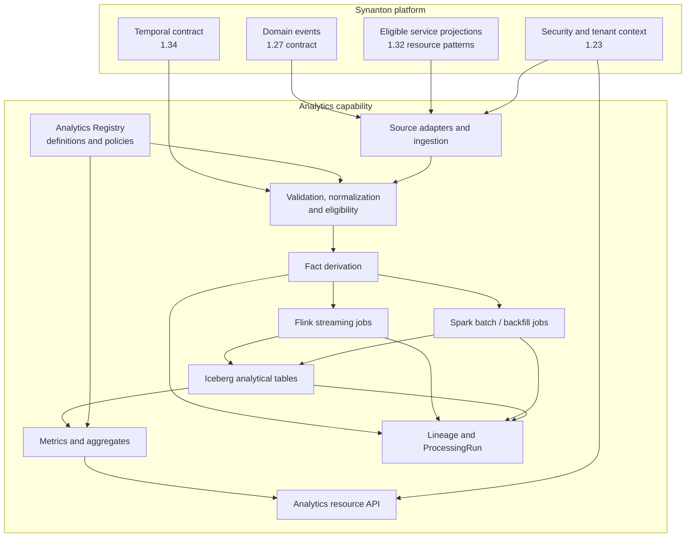

# Synanton Analytics — Implementation Architecture Proposal

<text></text>

**Status:** Draft for engineering review  
**Version:** 0.1  
**Scope:** Implementation architecture for the Analytics repository  
**Parent design:** [SNTP-036 — Analytics module design (Design 1.35)](https://github.com/synanton/platform/issues/474)  
**Repository:** [synanton/analytics](https://github.com/synanton/analytics)

---

## 1. Executive summary

Synanton Analytics is a platform capability for producing governed, traceable analytical observations from authoritative Synanton services. It consumes domain events and eligible service projections, derives facts and aggregates, maintains analytical lineage, and exposes results through the platform API.

This proposal recommends a JVM-first lakehouse architecture:

- **Apache Iceberg** for durable analytical tables and snapshot-based table evolution.
- **Apache Flink** for continuous, stateful event processing where streaming latency is required.
- **Apache Spark** for bounded batch transformations, historical backfills, and large recalculation jobs.
- **Java 21 and Gradle** for the initial implementation and shared domain/integration code.
- A catalog and object-storage implementation selected for the target deployment rather than hard-coded into domain logic.

Flink and Spark are complementary execution engines, not mandatory components in every workload. Iceberg is the analytical storage layer, not an event broker, operational database, authorization system, or end-to-end exactly-once guarantee.

The design preserves the most important platform invariant:

> Domain services own operational truth. Analytics owns derived observations and the metadata needed to explain them.

This document proposes an implementation decomposition and delivery sequence. It does not claim that the components or integrations described here are already implemented, nor does it replace the normative platform contracts.

## 2. Goals and non-goals

### 2.1 Goals

1. Ingest domain events using the platform's established asynchronous event contract.
2. Read service projections only through explicitly supported and security-eligible resource/adapter contracts.
3. Preserve source identity, source type, classification, tenant context, temporal semantics, and freshness throughout derivation.
4. Store analytical facts and aggregates in an evolvable table format.
5. Support both continuous processing and bounded batch processing without coupling domain logic to either engine.
6. Make metrics and derived results explainable through lineage and processing-run metadata.
7. Expose read-oriented analytical resources through the platform API conventions.
8. Coordinate content-affecting recalculation through Resolutor and Equalix rather than creating a parallel execution coordinator.
9. Support replay, backfill, correction, recovery, and retention as explicit operational workflows.

### 2.2 Non-goals

- Replacing domain databases or creating a second operational data plane.
- Replacing the platform event substrate, schema registry, outbox, or replay policy.
- Becoming a general-purpose BI product, dashboarding system, or semantic layer for arbitrary external data.
- Owning domain event schemas or platform API resource contracts.
- Exposing direct Iceberg, Flink, or Spark interfaces to platform clients.
- Requiring both Flink and Spark for every analytical workload.
- Introducing a new authorization, temporal, or long-running-operation model.

## 3. Normative platform constraints

The implementation must conform to these platform designs. This proposal adds implementation detail but does not redefine their contracts.

| Platform contract | Analytics obligation |
| --- | --- |
| [Design 1.23 — Security](https://github.com/synanton/platform/blob/main/docs/architecture/synanton-design-1.23.md) | Apply the normative security model; add strictest-input classification propagation, tenant-aware analytical access, and aggregate side-channel protection |
| [Design 1.27 — Async substrate](https://github.com/synanton/platform/blob/main/docs/architecture/synanton-design-1.27.md) | Consume the existing event envelope and schema registry; honor declared delivery, idempotency, replay, and event-type semantics |
| [Design 1.32 — API surface](https://github.com/synanton/platform/blob/main/docs/architecture/synanton-design-1.32.md) | Expose resources under the platform API lifecycle, versioning, authorization, error, and pagination conventions |
| [Design 1.34 — Temporal semantics](https://github.com/synanton/platform/blob/main/docs/architecture/synanton-design-1.34.md) | Preserve publication, observation, and validity times; classify corrections before recalculation |

### 3.1 Contract ownership

- The 1.27 schema registry owns event schemas. The Analytics Registry stores references and analytical mappings only.
- Design 1.32 owns API resource contracts. Analytics adds an API resource family; it does not introduce a parallel API lifecycle.
- Design 1.23 remains normative. Analytics-specific safeguards may strengthen but must not weaken it.
- Design 1.34 defines temporal meaning. Analytics must not collapse distinct timestamps into a generic event timestamp.

### 3.2 Implementation entry gates

The design is independent of implementation readiness. Phase 1 must not start until:

1. **EWP-2 is operational:** transactional outbox and publisher are working, and at least one real domain producer publishes events end-to-end through them. The first publisher interface slice alone is insufficient.
2. **Relevant 1.32 Generation-A patterns are operational:** resource/adapter conventions, error model, cursor pagination, and tenant context are available for the API and projection-read paths Analytics will use.

The frozen 1.27 contract is a design dependency already satisfied; it does not mean the outbox and delivery implementation are complete. The unified Operation model is required for later long-running exports/reports, not for the initial read-only foundation.

## 4. Architectural principles

### 4.1 Derived observations, never authority

Every analytical fact must be traceable to one or more source observations. An analytical result may be delayed, incomplete, corrected, or recomputed; it must never silently become the authoritative representation of a domain entity.

### 4.2 Source semantics remain explicit

Event-derived and projection-derived facts have different consistency, security, and freshness properties. Store the source kind and source reference with each derived fact and apply the appropriate eligibility rules.

### 4.3 Separate domain semantics from execution engines

Metric definitions, classification propagation, temporal rules, lineage, and correction semantics belong in engine-independent domain contracts. Flink and Spark adapters implement those contracts; they do not own the business meaning.

### 4.4 Reproducible derivation

A result should be explainable using source references, transformation/metric definition versions, processing-run identity, and relevant engine/table snapshot metadata.

### 4.5 Explicit delivery and consistency guarantees

Do not describe the complete pipeline as exactly-once merely because a component supports checkpoints or transactional commits. State guarantees per boundary and verify them with failure-injection tests.

## 5. Logical architecture



The diagram is logical. A deployment may combine components or omit an engine for a particular workload. The platform contracts and domain boundaries remain stable if the physical topology changes.

### 5.1 Responsibility boundaries

| Component | Owns | Must not own |
| --- | --- | --- |
| Source adapters | Connection to 1.27 event delivery and eligible 1.32 projection resources | Domain truth, event schema registry |
| Analytics Registry | Fact/metric/report definitions, policies, lineage metadata | Event schemas, API contracts, source records |
| Ingestion/normalization | Validation, source identity, deduplication keys, classification and temporal metadata propagation | Reinterpreting domain event semantics |
| Flink adapter | Continuous processing, keyed state, checkpoint coordination | Metric business definitions |
| Spark adapter | Bounded jobs, backfills, large recomputations | Independent correction policy |
| Iceberg adapter | Analytical table IO, catalog interaction, snapshot references | Authorization policy or event delivery |
| Analytics API | Governed read resources and query validation | Direct exposure of engine internals |
| Resolutor / Equalix | Planning and coordination of recalculation according to their contracts | Analytics-specific metric semantics |

## 6. Source integration

### 6.1 Event-derived facts

The event path consumes the 1.27 event envelope without redefining it. Analytics should retain the platform event identity, event type/schema reference, source domain, tenant/system context, publication time, and the replay/delivery metadata required by the contract.

The consumer should:

1. Validate the envelope and resolve the event schema through the 1.27 registry.
2. Verify that the event type is enabled for analytical consumption.
3. Apply event-type replay and retention rules as declared by the platform.
4. Record a stable source identity for deduplication and lineage.
5. Normalize only the fields needed for analytical derivation while preserving a reference to the source event.
6. Acknowledge/advance consumption only according to the selected delivery and persistence guarantee.

Analytics must not invent a second outbox, event envelope, schema registry, or replay classification.

### 6.2 Projection-derived facts

Projection reads are permitted only when the source service exposes an appropriate resource/adapter contract under Design 1.32 and the projection is approved for analytical use.

A projection adapter must define:

- Resource identity and tenant/system scope.
- Cursor or watermark semantics.
- Snapshot consistency and change-detection behavior.
- Deletion/tombstone behavior.
- Rate limits and backpressure behavior.
- Security eligibility and freshness expectations.
- How source revisions are identified.

Do not read another service's database tables directly as a shortcut. A projection read is an observation of a domain-owned view, not an ownership transfer.

### 6.3 Distinct source semantics

| Dimension | Event-derived | Projection-derived |
| --- | --- | --- |
| Primary meaning | A domain-declared occurrence or change | A service-exposed view at an observation point |
| Identity | Platform event identity | Resource identity plus source revision/cursor |
| Ordering | Contract-defined event ordering/replay class | Adapter-defined revision/cursor ordering |
| Freshness | Publication and consumer lag | Projection update and read observation lag |
| Replay | Event-type policy from 1.27 | Snapshot/change-cursor policy from adapter |
| Security | Event classification and tenant context | Projection eligibility and source access context |

The source kind must remain visible in lineage and query metadata. A projection snapshot must not be presented as an event history, and an event stream must not be treated as a guaranteed current-state projection.

## 7. Data model

The following are logical concepts. Physical schemas, partitioning, table formats, and API representations are implementation details to be versioned separately.

### 7.1 AnalyticsEvent

A reference to a consumed event plus the minimum metadata needed to process and trace it.

Suggested attributes:

- `source_event_id`
- `source_domain`
- `event_type`
- `schema_reference`
- `tenant_id` / system scope
- `classification`
- `published_at`
- `received_at`
- `consumer_position` or source delivery reference

The event payload should not be copied wholesale into long-lived analytical tables unless the analytical use case, classification, retention, and data-minimization review justify it.

### 7.2 AnalyticalFact

A normalized, derived observation.

Suggested attributes:

- Stable fact identifier and fact type.
- Subject/resource identity and tenant scope.
- Source kind: event or projection.
- Source reference(s) and source revision(s).
- Fact payload or typed measure/dimensions.
- Classification.
- `published_at`, `observed_at`, `valid_from`, `valid_to` where applicable.
- Derived-at time and derivation-definition version.
- Freshness metadata and processing-run reference.

### 7.3 Aggregate

A derived grouping over eligible facts.

Suggested attributes:

- Aggregate definition and version.
- Dimension keys and time window.
- Measure values and contributing fact/source references.
- Classification and tenant scope.
- Input freshness envelope.
- Computation version and processing-run reference.

### 7.4 MetricDefinition and MetricResult

A MetricDefinition is a versioned, declarative calculation contract: inputs, dimensions, measures, windowing, eligibility, classification behavior, and freshness requirements.

A MetricResult is a calculated output for a defined scope/window, including definition version, result value, classification, input freshness, and lineage references.

Metric definitions should be validated before activation. Changes that alter semantic meaning require a new version; historical results must remain interpretable against the definition version that produced them.

### 7.5 ReportDefinition

A later-phase declarative composition over approved metrics and facts. It is not an arbitrary SQL execution endpoint. Long-running report execution and export use the unified platform Operation model when available.

### 7.6 DataLineage and ProcessingRun

DataLineage connects a result to its source observations, derivation/metric versions, and output table snapshot references.

ProcessingRun records:

- Run identity, phase/type, and status.
- Input ranges, event positions, projection cursors, or source snapshots.
- Definition and code artifact versions.
- Engine and runtime version.
- Output table identifiers and Iceberg snapshot IDs.
- Start/end times, checkpoint/recovery information, and failure details.
- Recalculation request/correlation identity where applicable.

Lineage should be sufficient to explain how a result was produced without requiring indefinite retention of sensitive raw payloads.

## 8. Storage and processing technology

### 8.1 Apache Iceberg

Iceberg is the proposed table format for facts, aggregates, and selected processing metadata. It provides table snapshots and schema/partition evolution useful for analytical workloads.

The implementation must decide and document:

- Catalog implementation and availability model.
- Object-storage provider and credential isolation.
- Namespace and table ownership conventions.
- Schema evolution and compatibility policy.
- Partitioning strategy based on actual query and write patterns.
- Snapshot expiration, orphan-file cleanup, compaction, and retention.
- Encryption, access controls, and tenant isolation strategy.
- Writer ownership and concurrent commit behavior.

Iceberg snapshots are table-level versions; they are not a replacement for the 1.27 event log or a guarantee of cross-table atomicity. Multi-table workflows must define how readers identify a consistent processing version when required.

Tenant identifiers in partition paths are not an authorization boundary. Access control must be enforced independently of physical partitioning.

### 8.2 Apache Flink

Use Flink for workloads that require continuous event consumption, keyed state, event-time windows, or low-latency incremental derivation.

Responsibilities include:

- Consuming the 1.27 event stream through an adapter.
- Applying event-time and watermark semantics appropriate to each event type.
- Maintaining bounded or explicitly managed keyed state.
- Checkpointing source positions and operator state.
- Emitting derived facts/aggregates to Iceberg through a supported sink integration.
- Exposing lag, checkpoint health, backpressure, and failed-record metrics.

Flink should not become the only place where metric definitions or security rules exist. Those semantics must be represented in shared, testable contracts.

### 8.3 Apache Spark

Use Spark for bounded workloads:

- Initial historical backfills.
- Large batch transformations.
- Reprocessing a selected date/resource range.
- Compaction and maintenance jobs where appropriate.
- Large-scale recomputation after definition changes.

Spark jobs should be restartable and scoped. They must record input boundaries and output snapshots, and must not overwrite newer streaming results without a defined precedence and commit policy.

### 8.4 Engine selection

| Workload | Preferred starting point | Reason |
| --- | --- | --- |
| Continuous event-to-fact derivation | Flink | Stateful streaming and checkpointed consumption |
| Near-real-time rolling aggregates | Flink | Incremental windows and maintained state |
| Initial history load | Spark | Bounded, parallel batch processing |
| Large historical backfill | Spark | Explicit range-based batch execution |
| Metric query over stored results | API/query layer over Iceberg-backed data | Avoid launching a distributed job for every simple read |
| Long-running report/export | Later phase, unified Operation model | Durable operation lifecycle and progress |

A simple workload should not require both engines. The project should add the second engine only when a real workload requires it.

### 8.5 Write ownership and consistency

Concurrent Flink and Spark writes to the same table or overlapping logical data ranges require an explicit coordination strategy. The default recommendation is to assign a clear writer owner per table/workload and route historical corrections through controlled jobs rather than allowing uncoordinated writers.

The project must verify the exact consistency behavior of the chosen Iceberg catalog, Flink sink, Spark runtime, and their versions. Do not assume that a checkpoint plus an Iceberg commit automatically yields end-to-end exactly-once behavior across source, processing, and API visibility.

For the first implementation, prefer a conservative, testable guarantee: stable source identities, idempotent derivation, recorded table snapshots, bounded retries, and explicit recovery semantics. Strengthen the guarantee only when the complete failure path has been tested.

## 9. Security, classification, and tenant isolation

Security follows Design 1.23. Analytics adds controls required by derived data.

### 9.1 Classification propagation

For a fact derived from multiple inputs, its classification is at least the strictest classification among those inputs. A transformation must not downgrade classification because it removes fields, aggregates values, or writes to a different table.

For an aggregate, classification is computed from all contributing inputs within the aggregate's actual scope/window. If contribution membership changes, the effective classification must be recomputed or conservatively retained.

### 9.2 Aggregate side-channel protection

Aggregation can reveal sensitive information even when individual records are not returned. Query controls must consider:

- Minimum cohort/group sizes where appropriate.
- Differencing across overlapping queries.
- Rare dimensions and high-cardinality filters.
- Repeated queries over narrow time windows.
- Suppression and rounding policies where required by the applicable classification.

The exact policy should be metric- and classification-aware, not a universal hard-coded threshold.

### 9.3 Tenant and system scope

Tenant context must be validated at ingestion, carried through facts and aggregates, and enforced at query time. System-scoped data must follow explicit platform rules and must not become visible to tenant-scoped callers by omission or default behavior.

Object storage paths, Iceberg namespaces, catalog permissions, and API authorization are defense-in-depth controls; none alone substitutes for the platform security contract.

### 9.4 Projection eligibility

A projection can be consumed only if the source access path is authorized for the relevant tenant/system scope and its classification/freshness metadata is sufficient for the intended derivation. The analytical pipeline must not bypass source-service authorization by using internal storage credentials against a service's database.

## 10. Temporal semantics and freshness

Analytics must preserve the 1.34 timestamp distinctions:

| Timestamp | Meaning in Analytics |
| --- | --- |
| `published_at` | When the source event was published by its domain |
| `observed_at` | When a projection or source state was observed |
| `valid_from` | Start of the interval for which the fact is valid in the domain |
| `valid_to` | End of that validity interval, when known |

Processing timestamps such as `received_at`, `derived_at`, and `committed_at` may be added, but they do not replace the normative fields.

### 10.1 Freshness composition

A result depending on multiple inputs cannot claim freshness newer than its least-fresh required input. The API should expose enough freshness metadata for clients to distinguish:

- Current/within policy.
- Delayed but usable.
- Stale.
- Incomplete or partially unavailable.
- Unknown freshness.

The policy and thresholds belong to metric/source definitions and should be visible to consumers. A single global freshness threshold is unlikely to fit all domains.

### 10.2 Late and out-of-order data

Each streaming metric must define its event-time basis, watermark/late-arrival policy, correction behavior, and whether results are provisional or final. A late event may update a provisional aggregate or trigger a correction workflow; the choice must be explicit and traceable.

### 10.3 Corrections

Before any recalculation:

1. Identify the affected source facts and derived outputs.
2. Classify the correction as metadata-only or content-affecting under 1.34.
3. Determine the required recalculation scope and dependencies.
4. Coordinate the work through Resolutor and Equalix.
5. Record the correction, plan/run identity, input versions, and resulting snapshots.
6. Prevent an older processing run from publishing over a newer accepted result.

Metadata-only corrections should not trigger unnecessary full recomputation. Content-affecting corrections must not be silently applied directly to derived facts.

## 11. Analytics Registry

The Registry is the control-plane metadata boundary for Analytics. It should begin small and avoid becoming a second schema or API registry.

Initial responsibilities:

- Register analytical fact types and their source mappings.
- Register versioned metric definitions and aggregation rules.
- Record freshness and retention policies.
- Track lineage references and processing-run metadata.
- Validate definition activation and compatibility.

The Registry does not own event schemas, event delivery policies, API resource contracts, source-domain records, or platform authorization policy.

The physical persistence technology for registry metadata is intentionally not fixed here. Select it based on transactional requirements, query patterns, availability, and platform conventions; keep its interface behind a repository/port boundary.

## 12. API and query model

Expose analytical capabilities under the platform resource family:

```text
/v1/analytics/facts
/v1/analytics/metrics
/v1/analytics/metrics/{metricId}/results
/v1/analytics/aggregates
/v1/analytics/lineage/{resultId}
```

These paths are illustrative resource candidates, not finalized 1.32 API contracts. The final resource names, filters, pagination, errors, and authorization behavior must be expressed using Design 1.32 conventions.

API responsibilities:

- Validate caller tenant/system scope and classification eligibility.
- Validate metric/fact filters and supported time ranges.
- Enforce pagination and bounded query cost.
- Return freshness and completeness metadata.
- Expose lineage references appropriate to the caller's authorization.
- Avoid direct arbitrary SQL or unrestricted engine job submission.

The initial API is read-only. Metric registration, report execution, export, and other long-running commands are later-phase capabilities. MCP integration is a projection through the 1.32 MCP adapter, not a separate authorization or versioning model.

## 13. Reliability and operations

### 13.1 Failure boundaries

| Failure | Expected behavior |
| --- | --- |
| Event delivery unavailable | Consumer pauses/retries according to 1.27; lag is visible; no silent data loss |
| Projection source unavailable | Adapter backs off; cursor progress is not advanced past unpersisted observations |
| Flink job failure | Recover from a valid checkpoint or restart from a recorded source position; deduplication protects re-delivery |
| Spark job failure | Retry/restart a bounded run with recorded input boundaries; do not publish partial output as complete |
| Iceberg/catalog commit conflict | Retry only under a defined commit policy; surface conflicts and preserve run state |
| Registry unavailable | Fail closed for new/changed definitions; behavior for already-approved definitions is explicit and version-pinned |
| API query too expensive | Apply bounded execution, timeout, and pagination; return a platform-conformant error |

### 13.2 Observability

At minimum, expose:

- Event consumer lag and per-source ingestion throughput.
- Projection cursor age and source read failures.
- Invalid, rejected, duplicate, and quarantined records.
- Flink checkpoint duration/failure, backpressure, and restart count.
- Spark run duration, input/output volume, retries, and failure reason.
- Iceberg commit latency/conflicts, snapshot age, table growth, and maintenance backlog.
- Fact/metric freshness and incomplete-result counts.
- ProcessingRun status and lineage completeness.
- API latency, query cost, timeout rate, and authorization denials.

Metrics and logs must avoid leaking payloads or sensitive dimensions. Correlation IDs and processing-run IDs should make it possible to trace a result across source, processing, storage, and API boundaries.

### 13.3 Data quality

Validation should distinguish malformed source records, unsupported schema versions, ineligible source observations, business-rule failures, and transient infrastructure failures. Quarantine must preserve safe diagnostic metadata and source references without retaining sensitive payloads beyond policy.

## 14. Retention, deletion, and lifecycle

Retention applies to derived facts, aggregates, lineage, registry definitions, processing metadata, Iceberg snapshots, and object files. Policies must be coordinated so that snapshot expiration or file cleanup does not violate legal hold, lineage, or recovery requirements.

Deletion requests must consider:

1. Source-domain deletion/correction semantics.
2. Derived facts and aggregates that include the affected subject.
3. Recalculation or suppression requirements.
4. Iceberg snapshots and orphan-file cleanup.
5. Caches, exports, and downstream copies under Analytics control.
6. Lineage retention needed for audit, subject to the applicable policy.

Do not promise complete deletion merely because a row is no longer visible in the current Iceberg snapshot. The deletion workflow must define when historical snapshots and physical files are eligible for expiration and how completion is verified.

## 15. Phased implementation plan

### Phase 1 — Foundation

**Objective:** Establish a secure, read-only derived-fact path from a real platform source to an Analytics API resource.

Scope:
- Gradle/Java project structure and architecture tests.
- Minimal Analytics Registry contracts.
- One event-derived source adapter using the operational 1.27 path.
- One approved projection-derived adapter when its 1.32 resource contract is available.
- Initial fact schema and Iceberg catalog/table integration.
- Source identity, idempotent ingestion, classification, temporal metadata, and freshness.
- ProcessingRun and minimum lineage.
- Read-only 1.32-aligned API resource.
- Local integration environment and failure/recovery tests.

Exit criteria:
- At least one real domain producer publishes end-to-end through EWP-2.
- Relevant 1.32 Generation-A resource/adapter patterns are operational.
- Duplicate delivery does not create duplicate logical facts.
- Tenant and classification boundaries are tested.
- Facts retain source references and temporal fields.
- Freshness and incomplete states are visible.
- A failed/restarted ingestion run recovers without silently skipping data.
- API access follows 1.32 conventions.

### Phase 2 — Operational Analytics

**Objective:** Deliver reusable metrics and operational aggregates.

Scope:
- Versioned MetricDefinition and MetricResult.
- Initial Flink continuous processing for selected metrics.
- Aggregate storage and freshness monitoring.
- Bounded API query patterns and metric result resources.
- Definition compatibility and reproducibility checks.

Exit criteria:
- Metric definitions are versioned and validated.
- Results expose classification, tenant scope, freshness, and lineage.
- Aggregates enforce side-channel controls.
- Streaming results have explicit late-event and correction semantics.
- A metric can be reproduced from recorded source and definition versions.

### Phase 3 — Advanced Processing

**Objective:** Support controlled correction and recalculation.

Scope:
- Spark batch/backfill execution.
- Correction classification and impact analysis.
- Resolutor/Equalix coordination.
- Writer ownership and conflict handling between streaming and batch.
- ProcessingRun orchestration and recovery.

Exit criteria:
- Metadata-only corrections avoid unnecessary recomputation.
- Content-affecting corrections use the approved recalculation path.
- Older runs cannot overwrite newer accepted results.
- Backfills are bounded, restartable, and auditable.
- Streaming/batch parity is tested for metrics implemented by both engines.

### Phase 4 — Extended Analytics

**Objective:** Add report and export workflows and selected external integrations.

Scope:
- ReportDefinition and report query composition.
- Long-running report/export through the unified Operation model.
- Retention and deletion automation.
- External BI/consumer integration through governed contracts.
- Operational capacity, recovery, and cost controls.

Exit criteria:
- Long-running operations expose progress and terminal state through 1.32.
- Retention/deletion behavior is verified across tables and snapshots.
- External consumers receive governed, versioned interfaces.
- Recovery objectives and capacity limits are documented and tested.

## 16. Proposed repository structure

The following structure is a starting point. Create modules when the corresponding implementation slice is ready; avoid empty modules that only mirror boxes in an architecture diagram.

```text
analytics/
├── analytics-domain/           # Engine-independent domain concepts and rules
├── analytics-registry/         # Analytical definitions and metadata
├── analytics-ingestion/        # Source adapters and normalization
├── analytics-processing-api/   # Engine-independent processing contracts
├── analytics-flink/            # Flink jobs and streaming adapters
├── analytics-spark/             # Spark batch and backfill jobs
├── analytics-iceberg/          # Iceberg/catalog/storage adapters
├── analytics-api/              # Platform API resource adapters
├── docs/
│   ├── README.md
│   └── architecture/
│       └── analytics-implementation-proposal.md
├── README.md
├── settings.gradle.kts
└── build.gradle.kts
```

A single Gradle build is recommended initially. Keep Flink and Spark dependencies isolated in their adapter modules to avoid dependency conflicts and accidental engine coupling in the domain layer.

A Go component is not part of the initial structure. Introduce one only if it has a clear deployment/runtime boundary and measurable benefit; it must consume the same contracts rather than duplicate analytical domain logic.

## 17. Technology and version policy

This proposal selects technology families, not exact release numbers. Before implementation, pin mutually compatible supported versions of Java, Flink, Spark, Iceberg, catalog, and storage clients. Verify the compatibility matrix for the exact runtime and connector versions.

Version decisions must be recorded in build files and deployment manifests, not copied as unverified version assumptions into this proposal. Upgrade tests should cover table metadata compatibility, streaming checkpoints/savepoints, Spark read/write behavior, and catalog commit behavior.

## 18. Open design decisions

The following decisions must be closed before the relevant implementation phase:

| Decision | Needed by | Proposed direction |
| --- | --- | --- |
| Iceberg catalog and object storage | Phase 1 | Choose from platform deployment standards; keep behind adapters |
| Registry metadata persistence | Phase 1 | Use platform-standard transactional metadata storage; do not add a new database without need |
| First source event and fact type | Phase 1 | Select one domain producer with a real EWP-2 path and clear analytical value |
| First projection adapter | Phase 1/2 | Select a 1.32-compliant resource with explicit cursor and security semantics |
| Flink sink/commit guarantee | Phase 1/2 | Verify with the exact version matrix and failure tests; do not assume end-to-end exactly-once |
| Table and partition layout | Phase 1 | Derive from query/write patterns and data volume; avoid tenant partitioning as sole security |
| Streaming/batch writer ownership | Phase 3 | Single logical owner per table/range or an explicitly coordinated commit strategy |
| Metric definition representation | Phase 2 | Versioned, validated, declarative definition; avoid arbitrary SQL exposure |
| Aggregate disclosure policy | Phase 2 | Classification-aware controls, including small cohorts and differencing |
| Correction scope and conflict model | Phase 3 | Use Resolutor/Equalix and version-aware publication |
| Operation resource integration | Phase 4 | Use unified platform Operation model |

## 19. Acceptance checklist for this proposal

- [ ] Analytics remains a derived-observation capability; domain services remain authoritative.
- [ ] Event-derived and projection-derived facts have distinct source and freshness semantics.
- [ ] 1.27 event envelope and schema registry are reused without duplication.
- [ ] 1.23 security baseline is preserved and analytical classification/aggregate controls are added.
- [ ] 1.32 resource, API, pagination, error, tenant, and MCP conventions are reused.
- [ ] 1.34 temporal fields and correction classification are preserved.
- [ ] Analytics Registry owns analytical metadata only.
- [ ] Iceberg, Flink, and Spark are adapters/implementation choices behind stable domain contracts.
- [ ] Streaming/batch writer ownership and consistency guarantees are explicit and tested.
- [ ] Lineage and ProcessingRun make outputs explainable and reproducible.
- [ ] Resolutor/Equalix coordinate content-affecting recalculation.
- [ ] Phase 1 implementation gates are satisfied before implementation starts.
- [ ] Retention/deletion includes snapshots and physical data lifecycle.
- [ ] The design distinguishes proposed capabilities from implemented functionality.

## 20. References

- [SNTP-036 — Analytics module design (Design 1.35)](https://github.com/synanton/platform/issues/474)
- [Synanton Platform repository](https://github.com/synanton/platform)
- [Design 1.23 — Security](https://github.com/synanton/platform/blob/main/docs/architecture/synanton-design-1.23.md)
- [Design 1.27 — Async substrate](https://github.com/synanton/platform/blob/main/docs/architecture/synanton-design-1.27.md)
- [Design 1.32 — API surface](https://github.com/synanton/platform/blob/main/docs/architecture/synanton-design-1.32.md)
- [Design 1.34 — Temporal semantics](https://github.com/synanton/platform/blob/main/docs/architecture/synanton-design-1.34.md)
- [Resolutor](https://github.com/synanton/resolutor)
- [Equalix](https://github.com/synanton/equalix)

---

*Synanton Analytics — Observe. Derive. Explain.*
